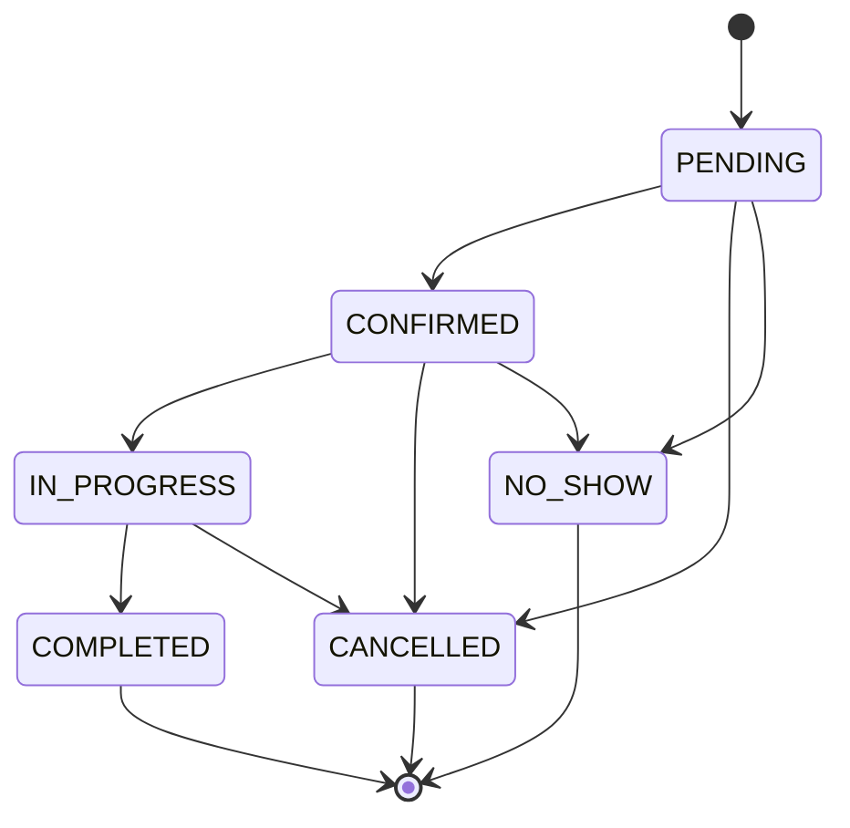
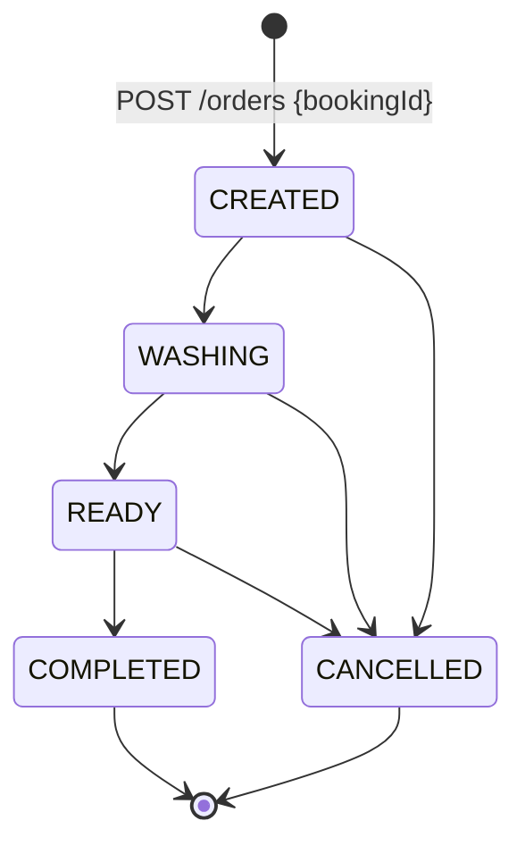

# API Reference (Summary)

Full interactive documentation (request/response schemas, try-it-out) is served
at **`/api/docs`** (Swagger UI) and **`/api/docs.json`** (raw OpenAPI 3.0 spec)
once the server is running. This file is a narrative summary; the running
Swagger UI is the source of truth for exact request/response shapes.

All endpoints are versioned under `/api/v1`, except `/health*` which is
intentionally unversioned (infrastructure probes, not part of the public API
surface).

## Response envelope

Single resource:
```json
{ "success": true, "data": { "...": "..." } }
```

List (always paginated):
```json
{
  "success": true,
  "data": [ { "...": "..." } ],
  "pagination": { "page": 1, "limit": 20, "total": 100, "totalPages": 5 }
}
```

Error:
```json
{ "success": false, "error": { "code": "FORBIDDEN", "message": "..." } }
```

`code` is one of: `VALIDATION_ERROR` (400), `UNAUTHORIZED` (401), `FORBIDDEN`
(403), `NOT_FOUND` (404), `CONFLICT` (409), `TOO_MANY_REQUESTS` (429),
`INTERNAL_ERROR` (500).

## Endpoint groups

| Group | Base path | Notes |
|---|---|---|
| Authentication | `/auth` | login, refresh, logout, me, forgot/reset-password - see [authentication.md](./authentication.md) |
| App | `/app` | `menu` (auth required), `config` (optional auth) - see [authorization.md](./authorization.md) |
| Car Washes | `/car-washes` | list/create/delete are `SUPER_ADMIN`-only; get/update are tenant-scoped to the caller's own car wash |
| Users | `/users` | tenant-scoped CRUD + `/:id/status`, `/:id/reset-password` |
| Roles | `/roles` | tenant-scoped custom roles + global system role templates; permission delegation enforced |
| Permissions | `/permissions` | read-only catalog |
| Services | `/services` | tenant-scoped CRUD |
| Customers | `/customers` | tenant-scoped CRUD |
| Vehicles | `/vehicles` | tenant-scoped CRUD; `customerId` must belong to the same tenant |
| Bookings | `/bookings` | create/update/cancel/complete; status state machine |
| Orders | `/orders` | check-in (create) + workflow status transitions |
| Reports | `/reports` | `summary` (tenant), `platform` (`SUPER_ADMIN`-only) |
| Health | `/health`, `/health/live`, `/health/ready` | unauthenticated |

## Booking status machine



A booking can only be edited (date/time/service/vehicle/notes) while `PENDING`
or `CONFIRMED`. Creating a booking validates the customer/vehicle/service all
belong to the caller's car wash, that the vehicle belongs to the given
customer, that the service is `ACTIVE`, and that no other active booking for
the same vehicle overlaps the requested time range (`endTime` is derived from
the service's `durationMinutes`).

## Order/job workflow



Staff see four states: **Waiting** (`CREATED`), **Washing**, **Ready** and
**Completed**. `CHECKED_IN` was removed (migration 0005 moved such orders back to
`CREATED`); `PATCH {status: "CHECKED_IN"}` from older app builds is treated as
`WASHING`.

Creating an order atomically confirms its booking (if still `PENDING`) in the
same DB transaction. Each order status transition keeps the linked booking's
status in sync in the same transaction (`WASHING`/`READY` →
booking `IN_PROGRESS`; `COMPLETED` → booking `COMPLETED`, and the booking's
`price` is copied onto `orders.total_amount`; `CANCELLED` → booking `CANCELLED`).

## Private and taxi rates

Each service has a `price` (private vehicles) and an optional `taxiPrice`
(`null` = taxis pay `price`). Bookings take `vehicleCategory` (`PRIVATE`, the
default, or `TAXI`). The server snapshots the matching rate into the booking's
`price` on create. It re-prices only when `serviceId` or `vehicleCategory`
changes, so later edits to a service's rates don't alter existing bookings.
Services always include the `taxiPrice` key, which clients use to detect the
feature.

## Rate limiting

Requests with a valid access token are limited per user
(`RATE_LIMIT_USER_MAX`, default 1000 per `RATE_LIMIT_WINDOW_MS`). This way,
staff sharing one public IP don't use up each other's quota. Anonymous requests
are limited per IP (`RATE_LIMIT_MAX`, default 100). Auth endpoints keep their
own stricter per-IP limiters.

## Pagination, filtering, search

Every list endpoint accepts `?page=1&limit=20` (`limit` capped at 100) and
returns a `pagination` block. Most also accept `search` (name/phone/email
substring match) and `status`; bookings additionally accept `dateFrom`/`dateTo`
and `customerId`.

## Example: mobile app session bootstrap

```bash
curl -X POST /api/v1/auth/login -d '{"phone":"9000000101","password":"Owner@123"}'
curl /api/v1/auth/me           -H "Authorization: Bearer $ACCESS_TOKEN"
curl /api/v1/app/menu          -H "Authorization: Bearer $ACCESS_TOKEN"
curl /api/v1/app/config        -H "Authorization: Bearer $ACCESS_TOKEN"
```
