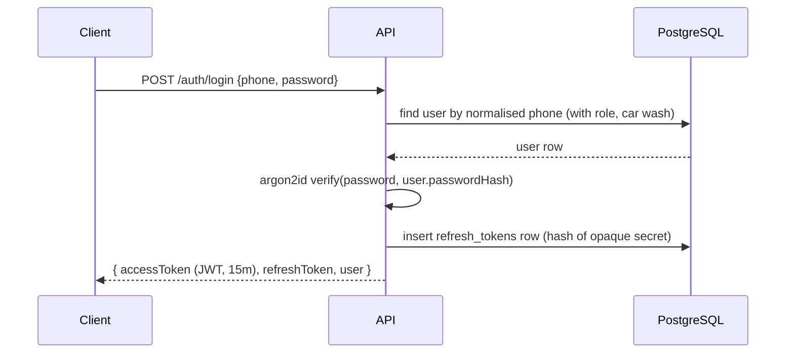
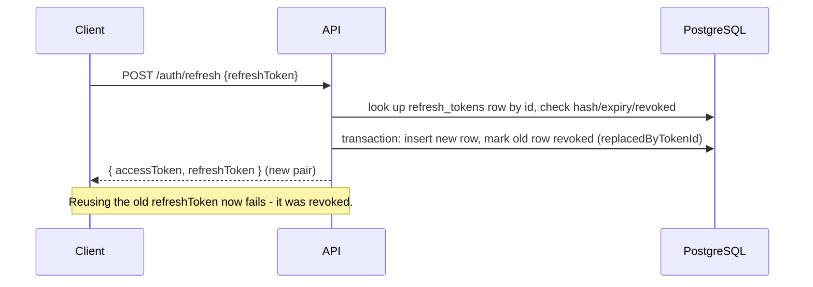

# Authentication

## Login and token issuance



- Users sign in with their **mobile number**. The API normalises it to E.164
  (`src/utils/phone.ts`: `98765 43210`, `+91-98765-43210` and `098765 43210` all
  become `+919876543210`); `users.phone` is stored that way and is unique among
  non-deleted users across **all** car washes, so a number identifies exactly one
  account (and therefore one car wash). `username` is still accepted in place of
  `phone` for older accounts without a number on file. Send exactly one of the two.
  The same applies to `/auth/forgot-password` and `/auth/reset-password`.
- Passwords are hashed with **argon2id** (`src/utils/password.ts`). Plaintext
  passwords are never logged or persisted.
- The **access token** is a signed JWT (`JWT_ACCESS_SECRET`, `ACCESS_TOKEN_EXPIRES_IN`,
  default 15m) carrying `sub` (user id), `carWashId`, `roleId`, `roleName`. It is
  *not* trusted for permissions - `authenticate` middleware re-resolves the
  user's current permissions from the database on every request, so a
  permission or role change takes effect immediately instead of waiting for the
  token to expire.
- The **refresh token** is *not* a JWT. It's an opaque `<rowId>.<secret>` string;
  only `sha256(secret)` is stored in `refresh_tokens.token_hash`. This makes
  refresh tokens individually revocable (logout, password reset, admin
  deactivation) without needing a blocklist.

## Refresh token rotation



Every refresh **rotates** the token: the presented token is revoked and a new
one issued in the same transaction. This means a leaked, already-used refresh
token is worthless to an attacker, and reuse of a revoked token is detectable.

## Logout

`POST /auth/logout` revokes the single refresh token presented. It does not
require the access token to still be valid (a user should be able to log out
even with an expired access token).

## Forgot password / reset password (code)

```mermaid
sequenceDiagram
    participant C as Client
    participant A as API
    participant Mail as Mail provider
    participant DB as PostgreSQL

    C->>A: POST /auth/forgot-password {phone}
    A->>DB: find user (does NOT reveal whether found)
    A->>DB: invalidate any existing active reset requests for user
    A->>DB: insert password_reset_tokens row (hash of userId + 6-digit code)
    A->>Mail: send the code
    A-->>C: 200 generic message (always, regardless of outcome)

    C->>A: POST /auth/reset-password {phone, code, newPassword}
    A->>DB: newest unused, unexpired request for that user
    A->>A: compare code (or DEV_RESET_CODE); wrong -> attempts+1, burned at 5
    A->>DB: transaction: update password hash (+ clear must_change_password), mark used
    A->>DB: revoke all refresh tokens for that user
    A-->>C: 200 success
```

Design decisions:

- **No user enumeration**: `/auth/forgot-password` returns the same `200`
  response and message whether the account exists, is inactive, or doesn't
  exist. `reset-password` gives the same "Invalid or expired code" error for an
  unknown user, no pending request, a wrong code or an expired code.
- **Short codes, bounded guessing**: codes are 6 random digits (`crypto.randomInt`),
  stored only as `sha256(userId + ":" + code)`. Each request allows 5 wrong
  attempts (`password_reset_tokens.attempts`) before it's burned, on top of the
  per-IP `authRateLimiter` (`AUTH_RATE_LIMIT_MAX`, default 20 per 15 min).
- **One-time use**: `used_at` is set transactionally with the password change,
  and any previously-issued active request is invalidated when a new one is made.
- **Expiration**: `RESET_TOKEN_EXPIRES_IN` (default 30m).
- **Dev code**: `DEV_RESET_CODE` (default `1111` outside production, unset in
  production) is accepted in place of the real code, but only while the user
  has a live request - so testers still go through "Send code". Setting it in
  production lets anyone who can request a code reset any account; the server
  logs a warning at startup if you do.
- **Session invalidation**: all of the user's refresh tokens are revoked on a
  successful reset, forcing re-login everywhere.
- **Email abstraction**: `src/utils/mailer.ts` exposes a `MailProvider`
  interface. `MAIL_PROVIDER=console` (default, development) logs the email
  instead of sending it; outside production, the code is also logged for users
  with no email on file. `MAIL_PROVIDER=smtp` is a stub production integration
  point - wire in `nodemailer` (or your provider's SDK) there.
- **Rate limiting**: `forgotPasswordRateLimiter` limits requests per
  `ip + phone` (or `ip + username`) combination (`FORGOT_PASSWORD_RATE_LIMIT_MAX`, default 5/hour).

## Admin-set passwords must be changed

When an owner/manager creates a user (`POST /users`) or resets someone else's
password (`POST /users/{id}/reset-password`), `users.must_change_password` is
set. Login and `/auth/me` return `mustChangePassword: true`, and the
`authenticate` middleware rejects every other endpoint with
`403 PASSWORD_CHANGE_REQUIRED` until the user calls
`POST /auth/change-password {currentPassword, newPassword}`. That clears the
flag, revokes the user's other sessions and returns a fresh token pair. The
code-based reset above also clears it (the user chose that password).

## Client session bootstrap

A mobile/web client initializes its session with, in order:

1. `POST /auth/login` → tokens + minimal user info
2. `GET /auth/me` → role, resolved permissions, car wash
3. `GET /app/menu` → the nested menu tree it's allowed to see
4. `GET /app/config` → branding/currency/timezone/feature flags

No role, permission, or menu logic is hardcoded in the client - see
[multi-tenancy.md](./multi-tenancy.md) and [authorization.md](./authorization.md).
