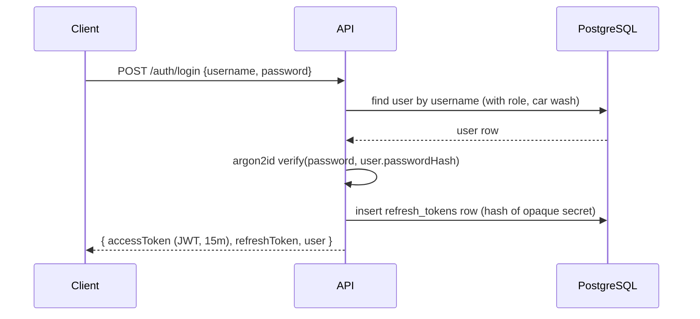
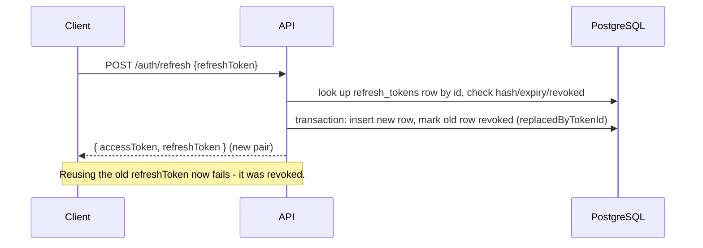
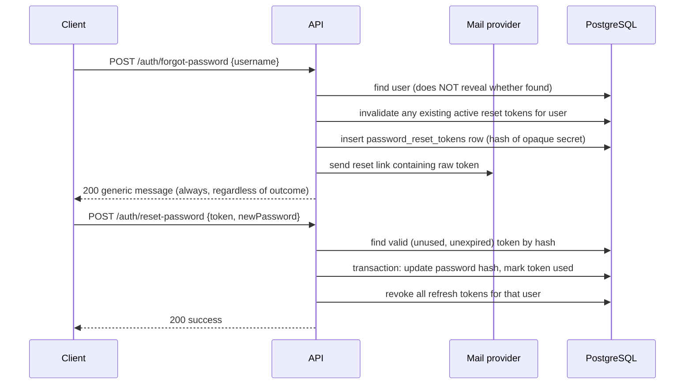

# Authentication

## Login and token issuance

- Passwords are hashed with **argon2id** (`src/utils/password.ts`). Plaintext
  passwords are never logged or persisted.
- The **access token** is a signed JWT (`JWT_ACCESS_SECRET`, `ACCESS_TOKEN_EXPIRES_IN`,
  default 15m) carrying `sub` (user id), `carWashId`, `roleId`, `roleName`. It is
  *not* trusted for permissions - `authenticate` middleware re-resolves the
  user's current permissions from the database on every request, so a
  permission or role change takes effect immediately instead of waiting for the
  token to expire.
- The **refresh token** is *not* a JWT. It's an opaque `<rowId>.<secret>` string;
  only `sha256(secret)` is stored in `refresh_tokens.token_hash`. This makes
  refresh tokens individually revocable (logout, password reset, admin
  deactivation) without needing a blocklist.

## Refresh token rotation

Every refresh **rotates** the token: the presented token is revoked and a new
one issued in the same transaction. This means a leaked, already-used refresh
token is worthless to an attacker, and reuse of a revoked token is detectable.

## Logout

`POST /auth/logout` revokes the single refresh token presented. It does not
require the access token to still be valid (a user should be able to log out
even with an expired access token).

## Forgot password / reset password

Design decisions (documented per the "choose a production-safe default and
record it" instruction):

- **No user enumeration**: `/auth/forgot-password` returns the same `200`
  response and message whether the username exists, is inactive, or doesn't
  exist. Timing differences are not addressed (out of scope for this project)
  but no *content* difference exists.
- **Hashed-at-rest tokens**: like refresh tokens, only `sha256(secret)` is
  stored; the raw token only ever exists in the (dev-logged or emailed) link.
- **One-time use**: `password_reset_tokens.used_at` is set transactionally with
  the password change, and any previously-issued active token for that user is
  invalidated when a new one is requested.
- **Expiration**: `RESET_TOKEN_EXPIRES_IN` (default 30m).
- **Session invalidation**: all of the user's refresh tokens are revoked on a
  successful reset, forcing re-login everywhere.
- **Email abstraction**: `src/utils/mailer.ts` exposes a `MailProvider`
  interface. `MAIL_PROVIDER=console` (default, development) logs the reset link
  instead of sending an email. `MAIL_PROVIDER=smtp` is a stub production
  integration point - wire in `nodemailer` (or your provider's SDK) there.
- **Rate limiting**: `forgotPasswordRateLimiter` limits requests per
  `ip + username` combination (`FORGOT_PASSWORD_RATE_LIMIT_MAX`, default 5/hour).

## Client session bootstrap

A mobile/web client initializes its session with, in order:

1. `POST /auth/login` → tokens + minimal user info
2. `GET /auth/me` → role, resolved permissions, car wash
3. `GET /app/menu` → the nested menu tree it's allowed to see
4. `GET /app/config` → branding/currency/timezone/feature flags

No role, permission, or menu logic is hardcoded in the client - see
[multi-tenancy.md](./multi-tenancy.md) and [authorization.md](./authorization.md).
