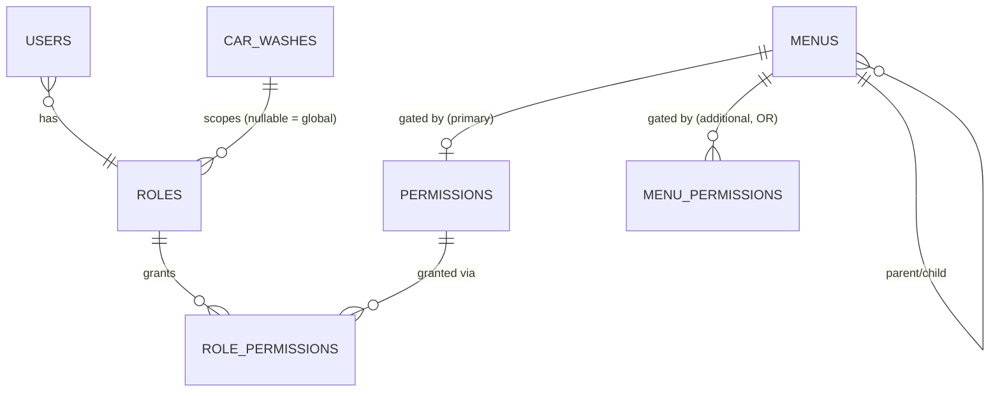

# Authorization (RBAC)

## Data model



- `permissions` is a flat catalog (`USERS_VIEW`, `SERVICES_CREATE`, ...) seeded
  from `src/constants/permissions.ts` (`PERMISSION_DEFINITIONS`) - see
  section 6 of the spec. Nothing in the authorization *code path* hardcodes this
  list; it exists only for seeding and for typed references
  (`requirePermission(PERMISSIONS.SERVICES_CREATE)`).
- `roles` rows with `car_wash_id = NULL` are **system role templates**
  (`SUPER_ADMIN`, `OWNER`, `MANAGER`, `STAFF`, `CUSTOMER`, seeded from
  `src/constants/roles.ts`). Rows with a `car_wash_id` are **custom roles**
  created by an owner/manager for their own tenant (e.g. "Receptionist").
- `role_permissions` holds each role's default permissions.
- `role_overrides` / `role_override_permissions` let a car wash customise a
  **system** role for itself (e.g. its STAFF can't update orders) without
  touching other tenants. `PATCH /roles/{id}` on a system role writes the
  caller's override (permissions only - built-in roles can't be renamed);
  `POST /roles/{id}/reset` removes it. Role responses include `isCustomized`.
- At request time `getEffectivePermissionKeys(roleId, carWashId)` returns the
  car wash's override for the role if one exists, else the role's defaults, as
  a flat `string[]` of permission keys. The middleware, `/auth/me` and role
  assignment checks all use it.

## Middleware

All in `src/middlewares/authenticate.middleware.ts` and
`authorize.middleware.ts`:

| Middleware | Purpose |
|---|---|
| `authenticate` | Verifies the JWT, loads the user + role + **fresh** permissions from the DB, attaches `req.user`. |
| `requirePermission(...keys)` | 403s unless `req.user.permissions` contains every key. |
| `requireAnyPermission(...keys)` | 403s unless it contains at least one. |
| `requireRole(...names)` | 403s unless `req.user.roleName` is one of the given names. Used sparingly, for platform-only actions like `requireSuperAdmin()`. |
| `requireCarWashAccess(resolver?)` | 403s unless the resolved target `carWashId` (default: `req.params.carWashId`) equals `req.user.carWashId`. `SUPER_ADMIN` bypasses this check. |

A protected route composes these, e.g.:

```ts
router.post(
  '/services',
  authenticate,
  requirePermission(PERMISSIONS.SERVICES_CREATE),
  validate({ body: createServiceSchema }),
  createService,
);
```

## Why permissions are re-resolved per request

The access token only carries `roleId`/`roleName` - not a snapshot of
permissions. `authenticate` calls `getPermissionKeysForRole(roleId)` on every
request. This costs one extra indexed join per request, but means an admin
editing a role's permissions (or a user's role) takes effect on the user's
*very next request*, not after their 15-minute access token happens to expire.

## Permission delegation ("can't grant what you don't hold")

When an OWNER/MANAGER creates a role or assigns a role to a user, the service
layer (`role.service.ts` → `assertDelegatablePermissions`,
`user.service.ts` → `assertCanAssignRole`) checks that:

1. Every permission being *added* is already held by the acting user
   (`req.user.permissions`), unless the acting user is `SUPER_ADMIN`. Removing
   permissions is always allowed.
2. The role being assigned is either a global template or belongs to the
   acting user's own car wash.
3. The `SUPER_ADMIN` role itself can only be assigned by an existing
   `SUPER_ADMIN`, and no tenant can customise it.
4. Nobody can change the permissions of their own role, so an owner can't lock
   everyone out by removing `ROLES_UPDATE` from `OWNER`.

This directly enforces spec section 12/13: "Owner cannot ... grant permissions
beyond their own allowed permission scope."

## Dynamic menu

`GET /app/menu` (`src/services/app.service.ts`) loads every active `menus` row
with its primary `permissionId` and any additional `menu_permissions` rows,
filters to the ones the caller's permission set satisfies (primary permission
OR any additional permission - OR semantics), and reassembles the
parent/child tree. The client renders whatever comes back; it has no built-in
notion of which menu items exist for which role.
