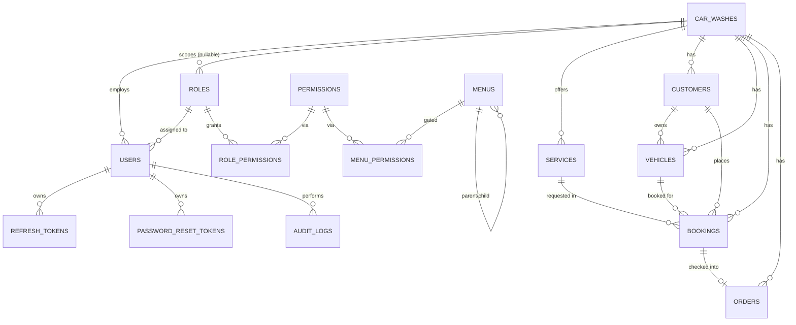

# Database

PostgreSQL, accessed through Drizzle ORM (`src/db/schema/*.ts`), migrated with
`drizzle-kit` (`src/db/migrations/*.sql`, generated - never hand-edited).

## Entity-relationship overview



## Tables

| Table | Notes |
|---|---|
| `car_washes` | Tenants. `status` ∈ ACTIVE/INACTIVE/SUSPENDED. Unique `code`. Soft-delete via `deleted_at`. |
| `permissions` | Flat catalog, unique `key`. |
| `roles` | `car_wash_id` nullable = global system role template; `is_system` blocks edit/delete via API. Partial unique indexes enforce unique names within "global" and within each tenant separately. |
| `role_permissions` | Join table, unique `(role_id, permission_id)`. |
| `users` | `car_wash_id` nullable only for `SUPER_ADMIN`. Unique `username` (global). `phone` is the E.164 sign-in number, unique among non-deleted users (partial index `users_phone_idx`). Soft-delete via `deleted_at`. |
| `menus` / `menu_permissions` | Nested menu tree (`parent_id` self-reference) with permission gating (primary `permission_id` plus OR'd `menu_permissions`). |
| `services` | Tenant-owned catalog. Unique `(car_wash_id, name)`. Soft-delete. `price` = private rate, nullable `taxi_price` = taxi rate. |
| `customers` | Tenant-owned. Indexed on `car_wash_id`, `phone`. Soft-delete. |
| `vehicles` | Belongs to a customer *and* denormalizes `car_wash_id` for fast tenant-scoped queries without a join. Unique `(car_wash_id, registration_number)`. Soft-delete. |
| `bookings` | `status` state machine (see [api.md](./api.md)). `vehicle_category` (`PRIVATE`/`TAXI`) and a `price` snapshot of the rate charged. Indexed on `car_wash_id`, `booking_date`, `customer_id`, `vehicle_id`, `status`. |
| `orders` | One-to-one with a `booking_id`. `status` workflow CREATED ("Waiting")→WASHING→READY→COMPLETED (or CANCELLED at any non-terminal step). Timestamps per stage transition. |
| `refresh_tokens` | `token_hash` only (sha256 of the opaque secret), `revoked_at`, `replaced_by_token_id` for rotation auditing. |
| `password_reset_tokens` | `token_hash` only, `used_at`, `expires_at`. |
| `audit_logs` | `user_id`/`car_wash_id` nullable (survives user/tenant deletion via `ON DELETE SET NULL`), free-form `metadata` JSONB. |

## Conventions

- **Primary keys**: `uuid` (`defaultRandom()`), never auto-increment integers -
  avoids leaking row counts/creation order across tenants.
- **Timestamps**: `created_at`/`updated_at` (`timestamptz`, default `now()`) on
  every table; services set `updated_at` explicitly on every `UPDATE`.
- **Soft deletion**: `deleted_at` on `car_washes`, `users`, `services`,
  `customers`, `vehicles` - repositories filter `WHERE deleted_at IS NULL`
  rather than physically deleting rows that other rows still reference
  (bookings, audit logs).
- **Foreign keys & cascade behavior**: tenant-owned rows `ON DELETE CASCADE`
  from their `car_wash_id`/parent (deleting a car wash cleans up its data);
  reference rows that other business records depend on (`customers`,
  `vehicles`, `services` referenced by `bookings`) use `ON DELETE RESTRICT` so
  a booking history can't be silently orphaned.
- **Indexes**: every `car_wash_id` column is indexed (the single most
  important index in a multi-tenant schema - it's in the `WHERE` clause of
  nearly every query); `users.username` and `bookings.booking_date` are
  indexed per spec section 22.
- **Transactions**: multi-table writes use `db.transaction(...)` - refresh
  token rotation, password reset (update password + mark token used), role
  permission replacement, and the order/job workflow (order status change +
  keeping its booking's status in sync).

## Migrations

```bash
npm run db:generate   # diff schema/*.ts against migrations/, write new SQL file
npm run db:migrate    # apply pending migrations (drizzle-orm's migrator, tracked in a
                       # __drizzle_migrations table)
npm run db:push       # (dev-only shortcut) push schema directly without a migration file
```

Migration `.sql` files are committed to the repo (`src/db/migrations/`) -
a fresh PostgreSQL database is brought fully up to date with `npm run db:migrate`
alone; no manual SQL is ever required.
