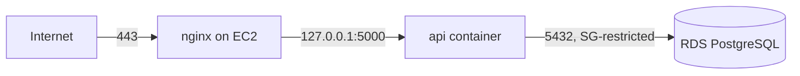

# Deploying to AWS: EC2 + RDS

This walks through hosting the API on a single EC2 instance with the database
on Amazon RDS for PostgreSQL - the smallest production-shaped setup that
reuses everything already in this repo (the multi-stage `Dockerfile`,
migrations, seed script).



Nothing here is AWS-console-specific dogma - swap RDS for any managed
Postgres and EC2 for any VM and the same steps apply.

## 0. Before you start

- An AWS account, and (only if you want to script step 1-3 instead of using
  the console) the AWS CLI configured locally: `aws configure`.
- A domain (or subdomain) you can point at the EC2 instance's IP, if you want
  real TLS. You can skip TLS initially and test over plain HTTP on the
  instance's public IP.
- Pick one AWS region and use it for everything below (e.g. `ap-south-1`).

## 1. Create the RDS PostgreSQL instance

Console: **RDS → Create database**

| Setting | Value |
|---|---|
| Engine | PostgreSQL, version 16.x |
| Templates | Free tier (or "Production" once you're past testing) |
| DB instance identifier | `carwash-db` |
| Master username | `carwash_admin` |
| Master password | generate and save in a password manager |
| Instance class | `db.t4g.micro` (free tier) or `db.t3.micro` |
| Storage | 20 GiB gp3 (free tier ceiling), enable storage autoscaling |
| Connectivity → VPC | your default VPC (or a dedicated one) |
| Public access | **No** - the DB should only be reachable from inside the VPC |
| VPC security group | create new: `carwash-db-sg` |
| Initial database name | `carwash` |

Equivalent CLI (run this yourself once `aws configure` has your credentials -
I can't run it for you in this session):

```bash
aws rds create-db-instance \
  --db-instance-identifier carwash-db \
  --engine postgres --engine-version 16.4 \
  --db-instance-class db.t4g.micro \
  --allocated-storage 20 --storage-type gp3 \
  --master-username carwash_admin --master-user-password 'REPLACE_ME' \
  --db-name carwash \
  --vpc-security-group-ids <carwash-db-sg-id> \
  --no-publicly-accessible \
  --backup-retention-period 7
```

Once it's `available`, copy its **endpoint** (RDS console → Connectivity &
security) - you'll use it in `DATABASE_URL`.

## 2. Create the EC2 instance

Console: **EC2 → Launch instance**

| Setting | Value |
|---|---|
| AMI | Ubuntu Server 22.04 LTS |
| Instance type | `t3.micro` (free tier) |
| Key pair | create/use one you have the `.pem` for |
| Network | same VPC as the RDS instance |
| Security group | create new: `carwash-api-sg` - inbound 22 (your IP only), 80, 443 from anywhere |
| Storage | 20 GiB gp3 is plenty |

## 3. Lock down security groups

- **`carwash-db-sg`** (attached to RDS): inbound rule allowing port `5432`
  from source **`carwash-api-sg`** (select the security group as the source,
  not a CIDR) - only the EC2 instance can reach the database, nothing else.
- **`carwash-api-sg`** (attached to EC2): inbound `22` from your IP only,
  `80`/`443` from `0.0.0.0/0`. Never open `5432` or `22` to the world.

## 4. Install Docker on the EC2 instance

```bash
ssh -i your-key.pem ubuntu@<ec2-public-ip>

curl -fsSL https://get.docker.com | sudo sh
sudo usermod -aG docker $USER
newgrp docker   # or log out/in
sudo systemctl enable docker   # containers with restart:always come back on reboot
```

## 5. Deploy the app

```bash
git clone <your-repo-url> car-wash-apis
cd car-wash-apis

cp .env.production.example .env
nano .env    # fill in DATABASE_URL (RDS endpoint), JWT secrets, CORS_ORIGIN, etc.
```

Generate real secrets rather than leaving the placeholders:

```bash
openssl rand -hex 64   # run 3x, one value each for JWT_ACCESS_SECRET / JWT_REFRESH_SECRET / JWT_RESET_SECRET
```

Build and start the API (uses the production `docker-compose.prod.yml` - no
local postgres/pgadmin, since the database is RDS):

```bash
docker compose -f docker-compose.prod.yml up -d --build
```

Run migrations, then seed **once** to bootstrap the platform admin. The
production image installs without devDependencies, so run the *compiled*
scripts directly with `node` rather than `npm run db:migrate`/`db:seed`
(those use `tsx`, a dev-only dependency that isn't in this image):

```bash
docker compose -f docker-compose.prod.yml exec api node dist/db/migrate.js
docker compose -f docker-compose.prod.yml exec api node dist/db/seed.js
```

> ⚠️ The seed creates `superadmin / SuperAdmin@123` and the demo
> `owner`/`manager`/`staff` accounts. **Log in as `superadmin` immediately and
> change the password** (there's no self-service "change my own password"
> endpoint yet - use `POST /users/{id}/reset-password` as the super admin
> against their own id, or reset it directly). Consider deleting the demo
> `owner`/`manager`/`staff` accounts and Sparkle Car Wash sample data once
> you've confirmed everything works, and creating your real first tenant via
> the super admin instead.

Verify:

```bash
curl http://localhost:5000/health
```

## 6. Put nginx + TLS in front of it

```bash
sudo apt-get update && sudo apt-get install -y nginx certbot python3-certbot-nginx
```

Copy `deploy/nginx.conf` from this repo, edit `server_name` to your real
domain, then:

```bash
sudo cp deploy/nginx.conf /etc/nginx/sites-available/carwash-api
sudo ln -s /etc/nginx/sites-available/carwash-api /etc/nginx/sites-enabled/
sudo nginx -t && sudo systemctl reload nginx

# Point the domain's A record at the EC2 instance's public IP first, then:
sudo certbot --nginx -d api.yourdomain.com
```

Certbot rewrites the nginx config in place to add the HTTPS server block and
redirect, and sets up auto-renewal via a systemd timer (`certbot.timer`) -
nothing further to configure.

## 7. Redeploying after code changes

```bash
cd car-wash-apis
git pull
docker compose -f docker-compose.prod.yml up -d --build
docker compose -f docker-compose.prod.yml exec api node dist/db/migrate.js   # only if new migrations exist
```

`restart: always` in `docker-compose.prod.yml` means the container also comes
back automatically after an instance reboot, as long as the Docker daemon
itself is enabled (`sudo systemctl enable docker`, done in step 4).

## 8. Production checklist

- [ ] RDS `Public access` is **No**; security group only trusts the EC2 SG
- [ ] Real, unique `JWT_*_SECRET` values (never the repo's dev defaults)
- [ ] `CORS_ORIGIN` is your real frontend domain, never `*`
- [ ] `MAIL_PROVIDER=smtp` wired to a real provider (SES, etc.) in
      `src/utils/mailer.ts` - the console provider is dev-only
- [ ] Default seeded passwords rotated or accounts deleted
- [ ] RDS automated backups enabled (on by default with the settings above;
      confirm retention period) and, ideally, deletion protection turned on
- [ ] `.env` on the EC2 instance is `chmod 600` and never committed
- [ ] `/health/ready` and `/health/live` wired into any monitoring you add later
- [ ] Consider AWS Secrets Manager or SSM Parameter Store instead of a plain
      `.env` file once you're managing more than one instance

## Alternative: no Docker on EC2

If you'd rather run the app directly with Node + a process manager instead of
Docker:

```bash
curl -fsSL https://deb.nodesource.com/setup_20.x | sudo -E bash -
sudo apt-get install -y nodejs
sudo npm install -g pm2

npm install
npm run build
pm2 start dist/server.js --name carwash-api
pm2 startup   # prints a systemd command to run once, so pm2 survives reboots
pm2 save
```

Migrations/seed are the same (`npm run db:migrate`, `npm run db:seed`), just
without the `docker compose exec` prefix. nginx/TLS setup (steps 3 and 6) is
identical either way.
