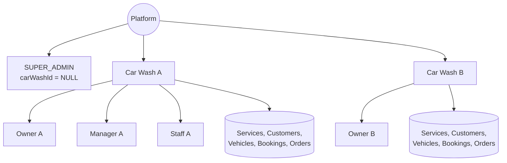
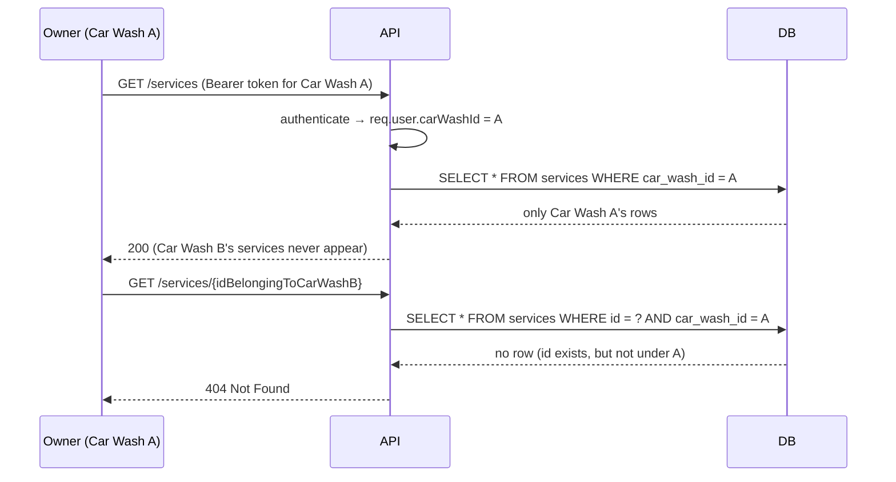

# Multi-Tenancy

## Model

Every tenant-owned table (`users`, `services`, `customers`, `vehicles`,
`bookings`, `orders`) has a non-nullable `car_wash_id` column with an index.
`SUPER_ADMIN` users (and only they) have `car_wash_id = NULL`, since they
operate at the platform level across every tenant.

## The rule: `carWashId` is always derived server-side

> A request body containing `"carWashId": "another-car-wash-id"` must never
> grant access to that tenant.

Concretely:

- **Every tenant-scoped repository function takes `carWashId` as an explicit
  parameter and `AND`s it into the `WHERE` clause** - e.g.
  `findServiceById(id, carWashId)`, never a bare `findServiceById(id)`.
  There is no code path that fetches a service, customer, vehicle, or booking
  by id alone.
- **Controllers derive `carWashId` from `req.user.carWashId`** (see
  `carWashIdOf(req)` helpers in `services/customers/vehicles/bookings`
  controllers), never from `req.body.carWashId` or `req.query.carWashId`. The
  Zod validators for these modules don't even declare a `carWashId` field, so
  one supplied by a client is silently dropped during body parsing.
- **User creation** (`user.service.ts::createUser`) sets
  `carWashId = actingUser.carWashId` unconditionally - a `carWashId` in the
  request body is ignored entirely (verified by
  `tests/tenant-isolation/tenant-isolation.test.ts`).
- **Cross-entity validation is tenant-scoped too**: creating a booking
  validates that the given `customerId`, `vehicleId`, and `serviceId` all
  resolve *within the caller's own `carWashId`* - a customer id that's valid in
  another tenant simply doesn't resolve (`findCustomerById(id, carWashId)`
  returns `undefined`), so the request fails validation rather than leaking
  which ids exist elsewhere.
- **Car wash records themselves** are gated by `requireCarWashAccess` (see
  [authorization.md](./authorization.md)): an owner can view/update only the
  car wash whose id matches their own `req.user.carWashId`; `SUPER_ADMIN`
  bypasses this since it manages the whole platform. Listing/creating/deleting
  car washes is `SUPER_ADMIN`-only (`requireSuperAdmin()`), so a tenant user
  can never enumerate other tenants even if they somehow held a
  `CAR_WASH_VIEW` permission.

## What this looks like end-to-end

Note the last case returns `404`, not `403` - the tenant-scoped `WHERE` clause
means the row simply doesn't match from Owner A's point of view, which avoids
even confirming that the id exists at all.

## Automated verification

`tests/tenant-isolation/tenant-isolation.test.ts` seeds a second tenant
("Shine Car Wash") with its own owner and data, and asserts that Car Wash A's
owner:

- Never sees Car Wash B's services/customers in list results.
- Gets `404` fetching Car Wash B's service/customer by id directly.
- Gets `403` viewing or updating Car Wash B itself, or a Car Wash B user.
- Cannot create a user under Car Wash B even when `carWashId` is injected into
  the request body.
- Cannot create a booking referencing a customer/service id from Car Wash B.

This suite is treated as a release gate - see the Testing section of the
[README](../README.md).
